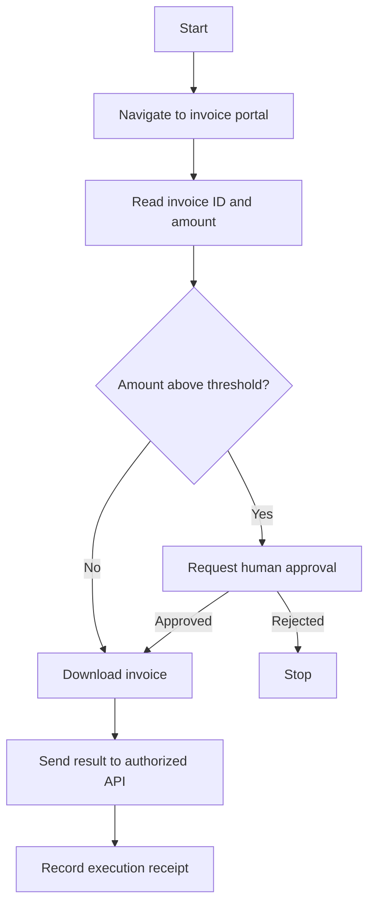
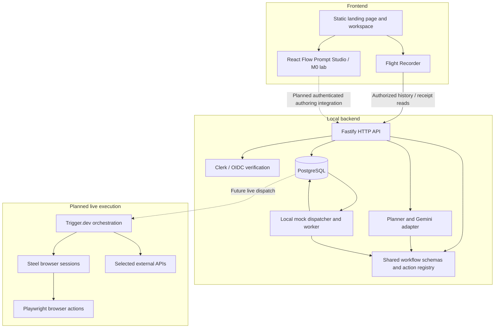

# Runspell

**Intelligence designs. Runspell executes.**

Runspell is an AI-assisted workflow automation platform designed to turn natural-language business requests into editable, validated workflows. It combines visual workflow authoring, typed action contracts, versioned execution, and evidence-based run history to make automation understandable before it runs and inspectable afterward.

Unlike an unrestricted autonomous browser agent, Runspell is designed around a clear separation between AI-assisted planning and deterministic execution. Users review the proposed workflow, authorize connections, validate the steps, and explicitly activate a version before execution.

> **Development status:** Active development. The frontend prototype, backend foundation, Gemini planning adapter, local mock execution, and Flight Recorder are present. Real browser/API execution, hosted deployment, production credential management, and scheduled/webhook execution are not yet complete.


[Quick start](#quick-start) · [Features](#features-and-current-status) · [Architecture](#architecture) · [API](#api-reference) · [Roadmap](ROADMAP.md)

## Table of contents

- [Why Runspell?](#why-runspell)
- [Features and current status](#features-and-current-status)
- [Example workflow](#example-workflow)
- [Architecture](#architecture)
- [Technology stack](#technology-stack)
- [Quick start](#quick-start)
- [Backend setup](#backend-setup)
- [Environment variables](#environment-variables)
- [API reference](#api-reference)
- [Repository structure](#repository-structure)
- [Testing](#testing)
- [Security and reliability](#security-and-reliability)
- [Roadmap](#roadmap)
- [Troubleshooting](#troubleshooting)
- [Contributing](#contributing)

## Why Runspell?

Business processes often span browser-only portals, APIs, human decisions, and repetitive data transfers. Traditional automation tools can require extensive manual configuration, while unconstrained AI agents can make execution difficult to reproduce, inspect, or govern.

Runspell aims to bridge these approaches:

- **Prompt-first authoring:** describe the business objective instead of wiring every step from scratch.
- **Visual control:** inspect, edit, and validate the generated workflow rather than treating an AI response as executable truth.
- **API-first, browser-when-needed:** prefer supported official APIs and events; use browser actions when the necessary capability is unavailable.
- **Explicit activation:** keep draft edits separate from immutable execution versions.
- **Evidence-first operations:** distinguish validation, simulated execution, and observed external outcomes.
- **Human control:** make approvals, unsupported actions, uncertain writes, and recovery visible instead of relying on autonomous self-repair.

Potential use cases include invoice collection, internal reporting, operational data synchronization, portal-based back-office tasks, and approval-driven workflows. These are intended applications, not claims of live integration support today.

## Features and current status

| Capability | Status | Details |
| --- | --- | --- |
| Landing page and workspace | Available | Buildless preview, scenario editor, dashboards, templates, dark mode and browser-local drafts; most dashboard data is simulated. |
| Visual workflow canvas | Available offline | Isolated React Flow editor, GSAP animations, shared workflow schemas and invoice fixture. |
| Prompt Studio | Available offline | Fixture-based prompt authoring, graph edits, reviewed mock revisions and draft recovery. |
| Workflow API and persistence | Implemented locally | Fastify CRUD for drafts, revision checks, PostgreSQL workspace policies and version records. |
| AI planning | Backend implemented | Gemini adapter, constrained candidate plans, reviewable patches, generation storage and event replay. A synthetic live Gemini smoke test is recorded in the roadmap; the Studio UI still uses fixtures. |
| Connection metadata | Implemented locally | Workspace-scoped pending/revoked records for browser and API connections; live credential attachment is not available yet. |
| Workflow validation | Implemented locally | Revision-checked validation without dispatch or external effects. |
| Mock execution | Implemented locally | Explicit mock activation, version pinning, idempotent admission, transactional outbox and one-run local dispatch. |
| Flight Recorder | Implemented for mock runs | Authorized run history, timelines, evidence and JSON receipts; local receipt viewer and Clerk history panel. |
| Identity | Local integration | OIDC bearer verification and Clerk development sign-in integration; actual Clerk sign-in requires a configured instance and enrolled user. |
| Live browser/API execution | Planned / provider gate pending | Trigger.dev orchestration, Steel browser sessions, Playwright actions and controlled external writes. |
| Production triggers and approvals | Planned | Scheduled and signed-webhook starts, durable live approval handling and production operations. |

## Example workflow

Consider a finance team that needs to collect an invoice from an authorized portal, check its amount, request approval above a threshold, then download and send the result to an internal system.

The invoice fixture models this class of workflow. A conceptual flow looks like:



This illustrates the intended controlled workflow. The current local mock engine uses synthetic outputs and does not sign in to a real portal, download actual invoices, send API notifications, or obtain real approval decisions.

### Supported action contracts

The versioned registry in [shared/registry.ts](shared/registry.ts) currently defines six actions:

| Action | Runtime | Purpose |
| --- | --- | --- |
| `browser.navigate` | Browser | Navigate to a validated HTTPS URL. |
| `browser.read_invoice` | Browser | Read invoice ID and amount using configured selectors. |
| `condition.compare` | Engine | Compare a numeric input against a threshold. |
| `human.approval` | Human | Represent a bounded approval decision. |
| `browser.download` | Browser | Represent a selector-based download and artifact reference. |
| `api.request` | API | Represent a typed GET or POST request. |

Each manifest declares its runtime, schema version, inputs, outputs, required scopes, side-effect classification, retry policy, evidence requirements and declared budget. The existence of an action contract does not imply that its live executor is implemented.

## Architecture

Runspell uses a single repository with an intentionally lightweight frontend shell, an isolated visual editor, shared TypeScript contracts, and a modular backend.



Solid arrows describe existing module relationships or supported local interfaces; dashed arrows identify planned integrations. The mock worker does not invoke the future provider stack.

### Workflow lifecycle

1. A prompt or manual edit creates a candidate workflow.
2. The shared schema and compiler validate action types, graph references, bindings and configuration.
3. Accepted changes become draft revisions; AI-proposed changes remain reviewable before application.
4. The user explicitly activates a revision into an immutable version (mock mode currently).
5. An idempotent run request admits the pinned version and creates durable dispatch work.
6. The local dispatcher processes a pending mock run and records simulated step results.
7. Authorized users inspect run history, evidence and a JSON receipt in Flight Recorder.

The production design adds real credential verification, live execution and controlled recovery to this lifecycle. See [BACKEND_PLAN.md](BACKEND_PLAN.md) for the detailed architecture and data model.

### Core engineering decisions

| Decision | Rationale |
| --- | --- |
| Shared typed contracts | Keep frontend, planner, compiler and execution semantics aligned. |
| Draft revisions and immutable versions | Prevent concurrent edits or later changes from silently altering a run. |
| PostgreSQL workspace boundaries | Scope persistence and access to authorized memberships. |
| Transactional outbox and idempotency | Separate durable admission from dispatch and limit duplicate logical work. |
| Ordered generation events | Allow clients to recover persisted planning outcomes and replay events. |
| Evidence and receipts | Make run outcomes inspectable and distinguish simulation from observation. |
| Bounded AI role | Prevent model output from becoming active execution without validation and authorization. |

## Technology stack

| Layer | Technology | Role |
| --- | --- | --- |
| Landing page / workspace | HTML, CSS, JavaScript | Buildless shell and interactive dashboard |
| Visual editor | React, TypeScript, React Flow (@xyflow/react) | Isolated workflow canvas |
| Motion | GSAP | Graph and interface animations |
| Bundling | Vite | Builds the isolated canvas bundle |
| Backend | Node.js, TypeScript, Fastify | HTTP API and application logic |
| Persistence | PostgreSQL, node-postgres (`pg`) | Drafts, versions, workspace records, generations and runs |
| Validation | Zod | Runtime schemas and typed action contracts |
| Identity | Clerk, OIDC, jose | Signed bearer-token verification and identity lookup |
| AI planning | Google Gemini | Schema-constrained generation via a provider adapter |
| Testing | Node test runner, tsx, Playwright, Python unittest | Contract, API, database and browser checks |
| Planned orchestration | Trigger.dev | Durable live task orchestration |
| Planned browser runtime | Steel, Playwright | Managed sessions and deterministic browser interactions |

Next.js, Liveblocks, Stagehand, Resend and other integrations are not required to run the current repository. See the roadmap for decisions on optional integrations.

## Quick start

### Prerequisites

- Git and Python 3 for the static preview.
- A modern browser.
- Node.js 24 or newer and npm for the canvas build and TypeScript backend (a recent Node version is recommended for the repository's native environment-file flags and current toolchain).
- PostgreSQL binaries (`initdb`, `pg_ctl`, `psql`) on your PATH for local backend and database tests; PostgreSQL 18 is the version recorded in the roadmap.
- Google Chrome and the Windows Python `py` launcher for the existing Playwright test configuration.

### 1. Clone the repository

The GitHub repository name includes a trailing period. The explicit destination below creates a normal local directory named `Runspell`.

```bash
git clone https://github.com/ashoka0402/Runspell..git Runspell
cd Runspell
```

### 2. Open the static preview

No npm installation, API credentials, or database are required for the basic preview.

Windows:

```powershell
py scripts/preview.py
```

macOS / Linux:

```bash
python3 scripts/preview.py
```

Open [http://localhost:8000/](http://localhost:8000/) and select **Open workspace**.

Use the supplied preview server rather than opening HTML files directly or exposing the entire repository through a generic static server. The supplied server binds to loopback and serves only allowlisted public assets.

### 3. Build the visual editor

In a separate terminal, from the repository root:

```bash
npm ci
npm run build
```

Keep the Python preview server running. The isolated canvas bundle is generated by the build; the landing page and ordinary workspace remain buildless.

| Page | Local URL |
| --- | --- |
| Landing page | [localhost:8000/](http://localhost:8000/) |
| Workspace overview | [localhost:8000/app/#/overview](http://localhost:8000/app/#/overview) |
| Scenarios | [localhost:8000/app/#/scenarios](http://localhost:8000/app/#/scenarios) |
| M0 compatibility lab | [localhost:8000/app/#/m0](http://localhost:8000/app/#/m0) |
| Prompt Studio | [localhost:8000/app/#/studio](http://localhost:8000/app/#/studio) |
| Flight Recorder | [localhost:8000/app/#/runs/recorder](http://localhost:8000/app/#/runs/recorder) |

Prompt Studio is currently fixture-based. The preview stores local drafts in browser storage, retaining the existing `brisko.workflow.drafts` key for compatibility.

## Backend setup

The API is optional for browsing the frontend. To explore the persisted backend and authorized run history, configure local PostgreSQL and an identity provider.

### 1. Create the private environment file

Windows PowerShell:

```powershell
Copy-Item .env.example .env
```

macOS / Linux:

```bash
cp .env.example .env
```

Only copy the template if `.env` does not already exist. Never commit credentials or overwrite an existing configured environment file.

### 2. Provision local PostgreSQL

```bash
npm run db:local
```

The bootstrap provisions an isolated database on `127.0.0.1:55432`, applies migrations, configures restricted local roles and writes generated connection settings into the ignored `.env`. Run it again after pulling new migrations; existing local records are preserved.

Run the database tooling as a regular user with PostgreSQL binaries on PATH.

### 3. Configure Clerk development identity

Create or select a development application in the [Clerk dashboard](https://dashboard.clerk.com/), create a test user, and set these values in `.env`:

```dotenv
CLERK_PUBLISHABLE_KEY=pk_test_your_publishable_key
RUNSPELL_CLERK_SUBJECT=user_your_test_user_id
```

Explicitly enroll the user into the local workspace:

```bash
npm run db:local -- --enroll-clerk
```

Alternatively, configure the OIDC issuer, audience and JWKS URL with a corresponding enrolled identity for non-Clerk development. See the [backend plan](BACKEND_PLAN.md) for identity and role requirements.

### 4. Start the API

```bash
npm run api:local
```

The API listens at `http://127.0.0.1:8002`. Keep the static preview running on port 8000, then navigate to **Runs → Flight Recorder**. The Clerk history panel uses a short-lived session token for authenticated reads.

### 5. Enable Gemini (optional)

Set your own development key in the private `.env`:

```dotenv
RUNSPELL_ENABLE_GEMINI=true
GEMINI_API_KEY=your_development_key
GEMINI_MODEL=gemini-3.1-flash-lite
```

Run the synthetic smoke check:

```bash
npm run test:gemini-live
```

This sends one fixed synthetic prompt to Gemini and validates the candidate draft locally. It may consume provider quota. The ordinary automated tests simulate model responses, and the browser Studio does not yet call the live planner. Disable the flag when live model calls are not needed.

### 6. Dispatch a pending mock run

After creating, validating and explicitly activating a draft in mock mode through the authorized API, admit a mock run with an idempotency key. With `RUNSPELL_MOCK_DATABASE_URL` set to the restricted worker login:

```bash
npm run dispatch:mock
```

Each invocation processes one pending mock run. Inspect its receipt through the authorized API, or download the JSON and open it with **Open receipt** in Flight Recorder. Mock results are simulated evidence, not external verification.

### Environment variables

All values belong in the Git-ignored root `.env`. See [.env.example](.env.example) for the canonical list.

| Variable | Purpose |
| --- | --- |
| `RUNSPELL_DATABASE_URL` | Restricted application database connection. |
| `RUNSPELL_IDENTITY_DATABASE_URL` | Separate identity lookup database connection. |
| `RUNSPELL_MOCK_DATABASE_URL` | Dedicated mock worker database connection. |
| `RUNSPELL_OIDC_ISSUER` | OIDC token issuer for non-Clerk development. |
| `RUNSPELL_OIDC_AUDIENCE` | Expected OIDC audience. |
| `RUNSPELL_OIDC_JWKS_URL` | OIDC public signing-key endpoint. |
| `RUNSPELL_ALLOWED_ORIGINS` | Comma-separated approved origins used by the API. |
| `CLERK_PUBLISHABLE_KEY` | Clerk development publishable key. |
| `RUNSPELL_CLERK_SUBJECT` | Test-user subject for explicit local enrollment. |
| `RUNSPELL_ENABLE_GEMINI` | Opt-in model generation switch; defaults to false in the template. |
| `GEMINI_API_KEY` | Gemini development API key. |
| `GEMINI_MODEL` | Model identifier; template defaults to `gemini-3.1-flash-lite`. |
| `TRIGGER_PROJECT_REF` | Trigger.dev development project reference for the pending live provider spike. |
| `TRIGGER_SECRET_KEY` | Trigger.dev development secret for the pending spike. |
| `STEEL_API_KEY` | Steel development API key for the pending spike. |

Trigger.dev and Steel credentials are not required for the current mock execution flow. The pending live read-only smoke test targets the Doe row on [this public demo table](https://the-internet.herokuapp.com/tables), expects a due amount of USD 100.00, and requires development credentials and an approved spending limit. See [Trigger.dev setup](https://trigger.dev/docs/manual-setup) and [Steel setup](https://steel.dev/docs/get-started/code).

## API reference

The local backend exposes versioned HTTP endpoints under `/api/v1`. Workspace routes use an authorized workspace UUID (`:wid`) and a verified identity. The table uses relative paths to keep the common prefix readable.

| Method | Path | Description |
| --- | --- | --- |
| GET | `/api/v1/me` | Resolve the authenticated user and workspace memberships. |
| GET, POST | `/workflows` | List or create workspace workflows. |
| GET, PATCH | `/workflows/:id` | Read or revision-check and replace a draft. |
| POST | `/workflows/:id/validate` | Validate a specific draft revision without dispatch. |
| POST | `/workflows/:id/activate` | Explicitly activate a revision in mock mode. |
| POST | `/workflows/:id/runs` | Admit an idempotent mock run. |
| GET | `/runs` | List authorized run history. |
| GET | `/runs/:runId` | Read a run and its pinned version. |
| GET | `/runs/:runId/evidence` | Retrieve recorded run evidence. |
| GET | `/runs/:runId/receipt` | Retrieve a JSON execution receipt. |
| POST | `/ai/generations` | Generate an inactive candidate draft. |
| GET | `/ai/generations/:gid` | Retrieve persisted generation status/outcome. |
| GET | `/ai/generations/:gid/events` | Retrieve ordered generation events. |
| POST | `/workflows/:id/draft/ai-edit` | Generate a reviewable edit proposal. |
| POST | `/workflows/:id/draft/apply-patch` | Apply an accepted patch. |
| GET, POST | `/connections` | List or create connection metadata. |
| DELETE | `/connections/:id` | Revoke a connection record. |

Except for `/api/v1/me`, prefix each path above with `/api/v1/workspaces/:wid`.

### Example: mock admission

For an existing workflow with an explicitly activated mock version:

```bash
curl -X POST "http://127.0.0.1:8002/api/v1/workspaces/$WORKSPACE_ID/workflows/$WORKFLOW_ID/runs" \
  -H "Authorization: Bearer $SESSION_TOKEN" \
  -H "Content-Type: application/json" \
  -H "Idempotency-Key: example-run-001" \
  -d '{"mode":"mock"}'
```

The variables must contain actual development values. Reuse the same idempotency key when retrying the same logical admission request. Do not expose session tokens in logs, shell history or shared screenshots. This Bash example does not create or activate the workflow.

For request schemas, authorization and response details, consult [server/src/app.ts](server/src/app.ts), [server/src/connections.ts](server/src/connections.ts) and the [backend API plan](BACKEND_PLAN.md#10-http-api-surface).

## Repository structure

```text
Runspell/
├── index.html                   # Landing page
├── relay-source/                # Landing styles, charts and animations
├── app/                         # Static workspace shell and scenario editor
│   ├── app.js
│   ├── workflow.js
│   ├── workflow-prompt.js
│   ├── recorder.js              # Flight Recorder
│   └── clerk-history.js         # Authenticated history panel
├── canvas/
│   ├── src/                     # Isolated React workflow editor
│   └── vite.config.ts
├── shared/                      # Registry, workflow and draft contracts
├── studio/                      # Prompt Studio state and editing model
├── fixtures/                    # Validated invoice workflow fixture
├── server/
│   ├── src/                     # Fastify API, identity, planner and mock worker
│   ├── migrations/              # PostgreSQL schema and access policies
│   ├── scripts/                 # Local database provisioning
│   └── tests/                   # Backend and database checks
├── tests/                       # Contract, frontend and browser suites
├── scripts/preview.py           # Loopback allowlisted frontend preview
├── docs/                        # M0/M1 feasibility and verification notes
├── .env.example
├── package.json
├── ROADMAP.md
└── BACKEND_PLAN.md
```

The existing `relay-source/` name is retained for compatibility following the Runspell rebrand.

## Testing

Install dependencies with `npm ci` before running npm scripts.

| Command | Purpose |
| --- | --- |
| `npm run typecheck` | TypeScript static checking. |
| `npm test` | Offline contract, Studio, Gemini adapter, mock execution and identity unit tests. |
| `npm run build` | Build the isolated visual canvas. |
| `npm run test:db` | Temporary PostgreSQL cluster, migrations, isolation and API integration tests. |
| `npm run test:browser` | Playwright browser checks using the configured local Chrome and Python launcher. |
| `py -m unittest discover -s tests -v` | Python frontend integration checks on Windows; use `python3` on macOS/Linux. |
| `npm run test:gemini-live` | Optional credentialed Gemini smoke test; may consume quota. |

Suggested offline verification sequence:

```bash
npm run typecheck
npm test
npm run build
npm run test:db
npm run test:browser
```

The PostgreSQL suite starts a temporary cluster on a free loopback port, applies migrations, runs integration checks, and removes the cluster. The Playwright configuration is currently Windows-oriented; other platforms may require adapting the launcher or Chrome configuration.

The [roadmap's recorded verification](ROADMAP.md#8-engineering-workflow-and-verification) for 27 November 2026 reports passing type checking, 40 TypeScript unit tests, 6 PostgreSQL integration tests, 11 Playwright tests and the frontend build. These are previously recorded project results, not a new test run performed for this README. The live Trigger.dev/Steel provider gate remains open.

## Security and reliability

The current code and architecture emphasize the following controls:

- Workspace-scoped data access and authenticated membership checks.
- Signed identity verification and separate database roles for application, identity lookup and mock dispatch.
- Revision checks, immutable execution versions and idempotent mock run admission.
- Strict action schemas, typed bindings and declared side effects.
- Pending/revoked connection metadata, approved origins and no live credentials in workflow definitions.
- Private environment files, allowlisted loopback preview assets and evidence that identifies simulated results.

Production readiness additionally requires real secret storage and credential verification, private artifacts, explicit activation gates for live execution, bounded retries, session cleanup, cancellation, quota enforcement, approval expiry, and human reconciliation of uncertain external writes. These requirements are documented in the backend plan and roadmap; they should not be treated as complete or audited production guarantees.

## Roadmap

| Milestone | Focus | Progress |
| --- | --- | --- |
| M0 | Contracts and provider feasibility | Offline verified; live provider gate pending |
| M1 | Visual Prompt Studio | Offline prototype verified |
| M2 | Backend foundation | Local persistence, APIs and identity implemented; remaining work in progress |
| M3 | AI authoring | Backend adapter and planning API implemented; representative prompt suite and frontend integration pending |
| M4 | Execution engine | Local manual mock execution implemented; real browser/API execution and triggers pending |
| M5 | Reliability and release readiness | Mock Flight Recorder and run history implemented; integrated live readiness pending |
| M6 | Connectors and document processing | Planned |
| M7 | Recording and reusable workflows | Planned |
| M8 | Advanced workflow and extension platform | Planned |
| M9 | Business and enterprise operations | Planned |

The first-release priority is a controlled, end-to-end prompt-to-receipt workflow with real authorized integrations, explicit activation, and recoverable execution. Broader connector coverage and enterprise features follow demonstrated demand.

### Further reading

- [Product and engineering roadmap](ROADMAP.md) — scope, milestones, verification and next steps.
- [Backend implementation plan](BACKEND_PLAN.md) — architecture, data model, HTTP APIs and operational requirements.
- [Revised product direction](additional.md) — product boundaries and expansion decisions.
- [Expansion addendum](Relay_Expansion_Addendum_2026-11-19.md) — historical supporting design material.
- [M0 contracts and feasibility](docs/M0.md) — offline compatibility and live-provider gate.
- [M1 Prompt Studio](docs/M1.md) — prototype behavior and verification.

## Troubleshooting

| Problem | What to check |
| --- | --- |
| Blank page or broken JavaScript | Serve the project using `scripts/preview.py`, not `file://`. |
| M0 lab or Studio fails to load | Run `npm ci` and `npm run build` from the root; reload the page. |
| Preview port is occupied | Pass another port to `scripts/preview.py`. The default Clerk local flow expects its configured origins, so retain port 8000 when using it unless you adjust the configuration. |
| Local API fails to start | Run `npm run db:local`, check the environment file and identity configuration, and ensure port 8002 is free. |
| Database checks fail | Ensure PostgreSQL binaries are on PATH and run as a non-root user. |
| Clerk sign-in works but no workspace appears | Verify the development user subject and rerun explicit enrollment. |
| Gemini smoke test fails | Check the opt-in flag, API key, model availability and provider quota. |
| Run remains pending | Ensure the mock worker database URL is configured and invoke `npm run dispatch:mock`. |
| Receipt is not accepted | Use a JSON receipt from the authorized receipt endpoint, not an arbitrary dashboard export. |

## Contributing

Keep changes focused on a single contract, UI feature, API, worker or migration. Follow the existing architecture rather than introducing a second workflow engine.

- Start with the relevant milestone and shared contracts.
- Add or update automated checks for behavioral changes.
- Preserve workspace isolation, idempotency, explicit activation and honest evidence semantics.
- Never commit secrets, provider tokens, real customer data or private browser artifacts.
- Clearly document untested behavior and distinguish mock results from live integration results.

Report issues and proposed changes through [GitHub Issues](https://github.com/ashoka0402/Runspell./issues).

---

**Runspell** — AI-assisted workflow design, controlled execution, and evidence you can inspect.

Maintained in [ashoka0402/Runspell.](https://github.com/ashoka0402/Runspell.)
